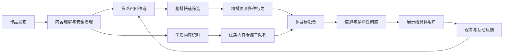

截至 **2026年11月18日**，抖音公开的信息足以还原推荐系统的主要流程，但不足以知道线上实时权重、流量池人数、单条作品的内部得分。下面按真正的算法管线讲，不把“完播率高就爆”这种口诀当算法本体。

### 1. 抖音推荐的本质

抖音不是先给每条作品打一个固定总分，再把高分作品推给所有人。它更接近：

> 对某一位用户、在某一个时间和场景下，从大量候选内容中预测他可能产生的多种反应，再综合排序。

因此，同一条视频面对不同用户，分数可以不同；同一个用户在不同时间打开抖音，看到的结果也会变化。

官方披露的输入大致分三类：

| 输入 | 公开可确认的例子 | 作用 |
|---|---|---|
| 用户特征 | 历史观看、停留、点赞、收藏、分享、划走、关注、偏好类别 | 理解用户可能喜欢什么 |
| 内容特征 | 画面、声音、字幕、标题、主题、语义及内容类别 | 理解视频在讲什么 |
| 上下文特征 | 时间、场景及当前会话行为 | 判断用户此刻可能需要什么 |

这些信息会被转成模型能够计算的数字特征或向量。官方课程用 Wide & Deep、双塔召回等模型解释这一过程，但课程示例不能直接视为完整的线上生产架构。[抖音“看懂算法”官方课程](https://95152.douyin.com/understand-algorithm)

### 2. 第一层：发布资格、内容理解与安全治理

作品上传后，系统首先需要读取和理解内容，包括：

- 画面中出现了什么；
- 语音和背景声音表达什么；
- 字幕、标题、话题和文案是什么；
- 内容属于哪个领域；
- 是否涉及违规、侵权、虚假信息或需要标识的生成式内容。

安全治理并非只在发布时检查一次，它可能贯穿召回、排序和最终展示。

这层会影响作品是否可以公开、是否限制可见范围，以及是否还能进入某些推荐路径。外部通常看不到具体命中了哪个模型或内部标签，所以“播放低”本身不能证明作品被处罚。

对于AI配音、AI画面和合成视频，抖音要求符合条件的内容进行标识。主动标识、平台检测提示和文件元数据属于不同环节。官方没有公开“只要打AI标签就统一降权”的规则，也没有公布“克隆本人声音自动免标”的豁免。[抖音AI内容标识公告](https://95152.douyin.com/article/69831756697378034)

### 3. 第二层：多路召回

抖音每天新增的内容量极大，系统不可能对所有作品进行完整精排。因此它会先通过多条路径找出一批候选，这一步叫召回。

官方披露的典型思路包括：

- 根据用户长期兴趣召回相似内容；
- 根据最近连续观看和互动形成的短期兴趣召回；
- 根据相似用户的行为召回；
- 从热门或具有公共兴趣的内容中召回；
- 对新兴趣、少见类别和新内容进行探索；
- 根据用户与内容向量之间的距离寻找匹配内容；
- 关注关系、社交关系及其他产品入口也可能形成候选来源。

官方课程的说明是：系统需要在很短时间内，从海量内容中筛出数千条候选，配套文章举例约为 **50毫秒**。这是科普层面的量级说明，不是每条作品都能获得数千次曝光的承诺。[《系统讲透推荐算法》官方配套说明](https://95152.douyin.com/article/9931789713977376)

某条作品没有被某一路召回，不代表全站删除；它只是没有通过这一条路径参加后续排序。

这也是为什么“互动权重很高”不能解释所有低播放：如果作品没有进入某位用户当次的候选集合，后面的互动预测权重暂时与它无关。

### 4. 第三层：粗排

多路召回后，候选数量仍然很大。系统会使用计算速度更快的模型进行粗排，把明显不相关或预估价值较低的候选快速筛掉。

粗排解决的是效率问题：

- 精排模型更复杂，无法对所有候选都运行；
- 粗排尽量保留可能表现好的内容；
- 同时快速削减候选数量。

官方课程还介绍了学习排序和知识蒸馏等方法。但公开材料没有披露当前线上粗排模型、候选截断数量及各类内容的通过阈值。

创作者无法从最终播放量判断作品具体是在召回还是粗排阶段失去机会。

### 5. 第四层：精排预测

剩余候选会进入更精细的预测阶段。系统预测的通常是：

> 这位用户看到这条作品后，发生某种行为的概率或预期值。

公开材料提到的行为包括：

- 是否观看；
- 观看多久；
- 是否较快划走；
- 是否点赞；
- 是否评论；
- 是否收藏；
- 是否分享或转发；
- 是否关注作者；
- 是否复访；
- 是否表达不喜欢。

这里预测的是“某个用户可能产生行为的概率”，不是把已经发生的互动次数直接相加。

所以不能这样理解：

> 1个收藏等于多少点赞，1次评论抵多少完播。

抖音没有公开这些行为当前的数值权重。网上流传的点赞、评论、转发比例表，没有可核实的官方依据。

### 6. 第五层：多目标融合

抖音明确表示，推荐不只追求点击率，也不只看完播率。系统需要在多个目标之间取得平衡。

可能参与融合的目标包括：

- 当前观看兴趣；
- 观看时长和观看质量；
- 点赞、评论、收藏和分享；
- 关注和复访等长期价值；
- 内容多样性与新鲜感；
- 优质内容供给；
- 创作者生态体验；
- 内容安全和平台治理要求。

这对知识类长视频尤其重要。一条4分钟科普视频可能没有极高的整条完播率，但如果用户观看时间长、收藏、分享、关注或后来再次观看，系统仍可能识别出它的长期价值。

因此，下面三个说法都不成立：

- “完播率不到某个百分比就停止推荐”；
- “长视频天然吃亏”；
- “只要完播率高就一定进入下一级流量池”。

官方没有公开统一阈值。

### 7. 第六层：重排、多样性与探索

精排得到候选分数后，系统还会调整最终列表。

重排可能处理：

- 连续出现过多相同主题；
- 连续出现同一作者；
- 内容形式过于重复；
- 新鲜内容和熟悉内容之间的平衡；
- 用户短期兴趣与长期兴趣之间的平衡；
- 热门内容与探索内容之间的平衡。

官方课程用DPP等方法解释多样性，但这不证明线上只有一种算法，也不能把其他平台公开的DPP参数套到抖音。

探索机制的意义是：系统会拿出一部分机会测试用户尚未充分表现出的兴趣，也为新用户和新内容解决历史数据不足的问题。

探索不等于固定保底播放。官方没有公开“新作品先给500人，数据好再给3000人”这种固定阶梯。

### 8. 新账号和新视频怎样冷启动

冷启动分成两个问题。

**新用户冷启动**

新用户缺少历史记录，系统可能先使用：

- 热门和较普适内容；
- 注册、设备、地区及场景允许使用的基础信息；
- 用户主动选择的兴趣；
- 刚开始产生的观看、停留和划走行为。

随后通过探索逐渐缩小兴趣范围。

**新作品冷启动**

新作品缺少播放和互动记录，系统可以利用：

- 视频本身的画面、声音、字幕和语义；
- 标题、话题、领域和作者历史；
- 内容与用户兴趣向量的匹配；
- 一定程度的探索展示；
- 展示后产生的真实观看与互动反馈。

新作品不是完全没有机会，但没有公开证据证明每条作品都获得固定人数的初始流量。

系统会不断根据反馈更新判断。早期反馈重要，但官方没有公布“前30分钟”“前500播放”这样的统一生死线。

### 9. 优质内容还有一条专门路径

抖音在2026年9月公开了较详细的优质内容识别和分发机制。

官方描述的流程大致是：

1. 通过人工质量样本训练内容理解模型；
2. 使用轻量模型先缩小内容范围；
3. 再通过更深入的多模态模型判断内容质量；
4. 识别出的内容可以进入独立的准入和评价机制；
5. 进入优质内容专属推荐子队列；
6. 专属队列与其他推荐队列混合后形成用户的信息流。

这条路径说明“内容质量”不只是观看数据的另一种叫法，平台还会直接理解内容本身。[抖音优质内容大模型官方说明](https://95152.douyin.com/article/2831789467827967)

官方概括的质量体验包括：

- **有收获**：用户获得知识、方法或新的理解；
- **有新意**：内容提供新的信息、视角或表达；
- **表达清楚**：信息组织明确，用户容易理解；
- **能产生共鸣**：内容具有真实情绪或感染力。

这些是质量判断维度，不是四个公开打分项，也没有公开合格分数。

### 10. “懂行用户”怎样影响质量判断

抖音还披露了一种人群模型：系统会在不同兴趣领域识别具有较强内容鉴赏能力的用户，根据他们长期、稳定、具有区分度的观看和互动反馈，帮助校准优质内容标准。

这里的“懂行用户”不等于：

- 粉丝多的大V；
- 认证账号；
- 平台工作人员；
- 点赞一次就能给作品带来大量流量的人。

他们更像是领域质量反馈的一类信号来源。系统会把这些反馈用于训练或修正内容质量模型，再让模型大规模识别作品。[抖音“懂行用户”与人群模型官方说明](https://95152.douyin.com/article/8561789469279698)

这也意味着，优质内容标准会随着领域和用户体验变化。科普、美食、生活记录和艺术内容，不会只套用同一套视觉模板。

### 11. 作品发布后，反馈怎样形成循环

作品展示后，用户行为会重新进入系统：

1. 系统选择候选并展示；
2. 用户观看、划走或互动；
3. 行为成为新的反馈；
4. 系统更新对用户兴趣、作品特征和作者内容的理解；
5. 后续召回和排序发生变化。

需要特别注意：

- 一次点赞不等于系统已经确认作品优质；
- 完播也可能来自视频很短；
- 评论多也可能来自争议或误解；
- 播放时间长可能来自内容价值，也可能来自信息难懂；
- 快速划走表达负反馈，但无法从外部知道具体内部影响；
- 收藏、分享、关注、复访可能体现长期价值，但官方未公布系数。

模型通常综合多个行为及其上下文，而不是只看单一数字。

### 12. 创作者后台能看到什么

普通创作者中心公开前端说明可确认以下字段：

| 指标 | 可确认的官方口径 | 仍然不知道的部分 |
|---|---|---|
| 完播率 | 完整播放对应的播放量占总播放量 | 重播、异常流量、末帧判定 |
| 5秒完播率 | 播放超过5秒的播放量占总播放量 | 短于5秒作品及恰好5秒的底层处理 |
| 2秒跳出率 | 播放后2秒内跳出的播放量占总播放量 | 暂停、退出和重新进入如何判定 |
| 平均播放时长 | 视频被播放的平均持续时间 | 分母按播放次数还是其他去重口径，官方未完整披露 |
| 周期作品平均时长 | 所选周期作品的均播时长再取平均 | 不能等同全账号观看总时长÷总播放量 |

部分作品列表指标按小时更新，另一些分析视图按天更新或统计到作品发布后30天。不同页面的数字不能随意混算。[抖音创作者中心](https://creator.douyin.com/)

### 13. 网上最常见的算法传闻

| 传闻 | 当前证据结论 |
|---|---|
| 抖音固定分为500、3000、1万等流量池 | 无官方证据证明所有作品按固定人数逐级晋升 |
| 完播率达到某个百分比必爆 | 无统一公开阈值 |
| 点赞、评论、转发有固定换算比例 | 内部权重未公开 |
| 新号必有保底播放 | 有探索机制，不等于保底曝光 |
| 发出后两小时决定全部命运 | 早期反馈有作用，但没有统一两小时生死线 |
| 粉丝越多，所有新作品初始分越高 | 作者历史可能成为特征，但没有公开固定粉丝乘数 |
| 使用AI配音会统一限流 | 有标识和治理规则，没有公开统一降权规则 |
| 打上精选标识就固定获得多少曝光 | 优质内容有专属路径，倍数和保底未公开 |
| 删除重发可以重新进入流量池 | 无统一保证，还可能损失原有反馈与作品记录 |
| 买DOU+能够激活自然推荐 | 付费投放与自然推荐关系不能用这一句话概括，公开材料没有这种保证 |

### 14. 对创作者真正有用的理解

对你的科普类账号，应该把一条作品看成四个连续问题：

1. **系统能不能理解它？**  
   标题、声音、字幕和画面是否共同说明一个清晰主题。

2. **它能不能找到合适的人？**  
   作品是否属于明确的知识领域，内容是否让系统获得足够的语义信息。

3. **用户看到后是否愿意继续？**  
   开头是否快速交代问题和观看收益，正文是否持续兑现。

4. **看完后有没有长期价值？**  
   用户是否愿意收藏、分享、关注、复访，或者提出有内容的评论。

这四层比追逐一个完播率阈值更接近抖音公开的真实机制。

目前仍然不能知道：线上实时权重、候选数量、各队列占比、某条视频具体在哪一层出局、账号内部质量标签、优质队列阈值及AI标识的量化影响。这些必须保持“未知”，不能用播放量倒推出一个确定答案。
